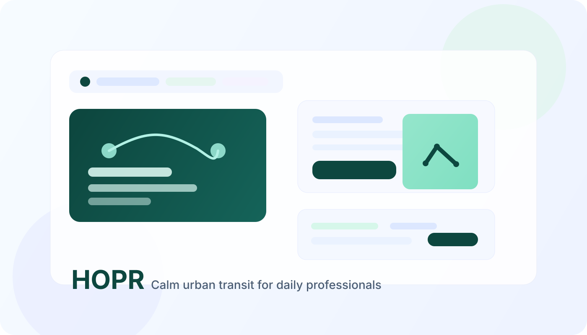
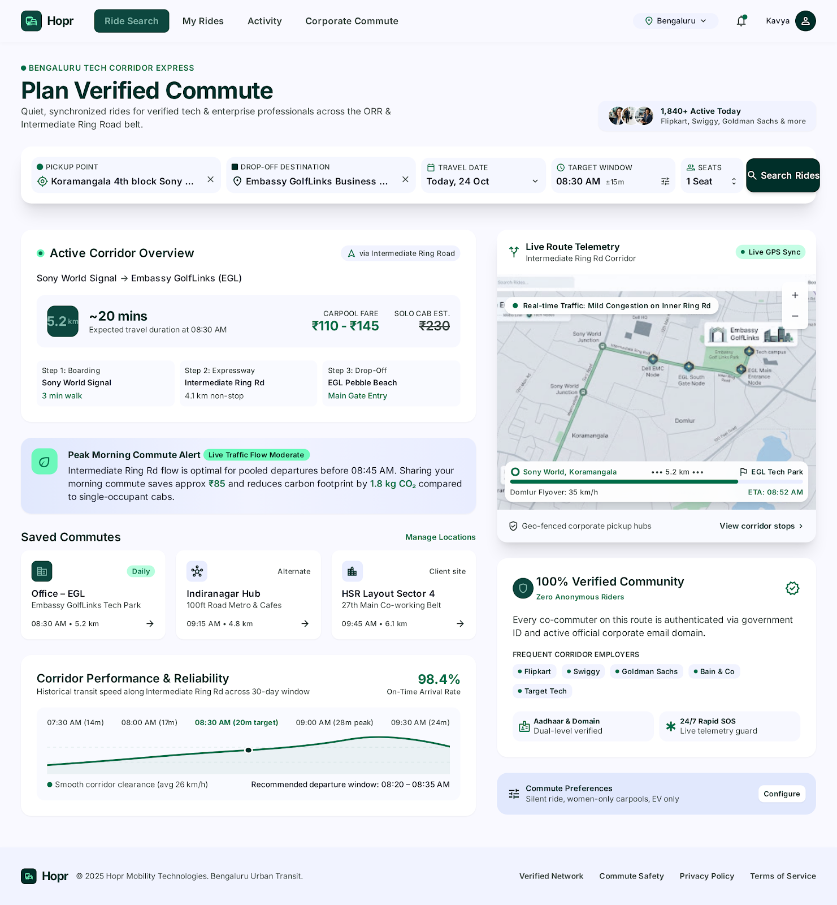
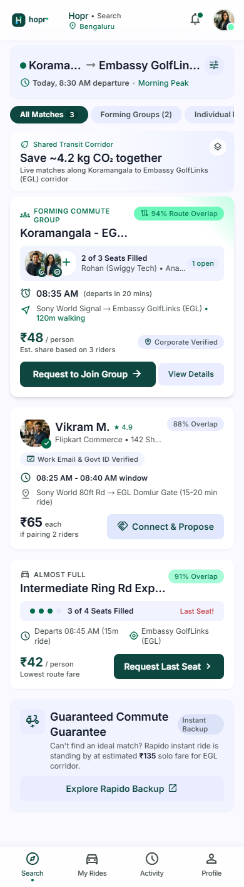
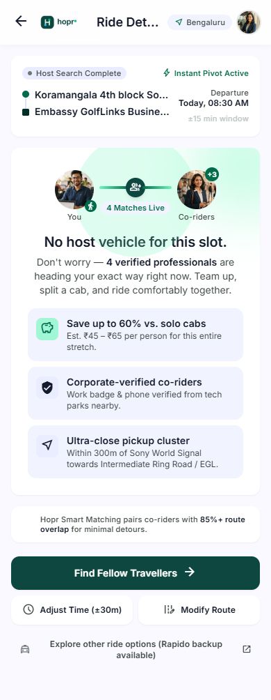
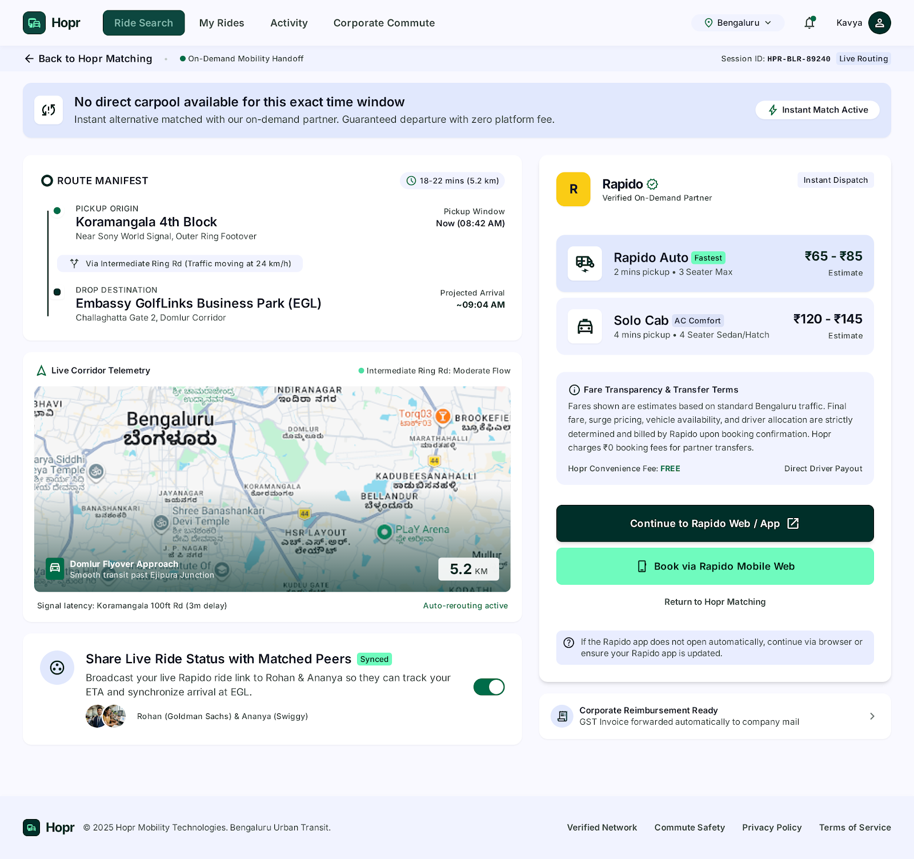

# HOPR

<p align="center">
  
</p>

<p align="center">
  
  
  
  
</p>

A polished, product-story-driven portfolio project inspired by the HOPR PRD. This repository presents a calm commuter marketplace concept that focuses on trust, route clarity, and repeatable habit formation for urban professionals.

## Overview
HOPR is a concept product designed to improve the daily commute experience for people who want dependable, verified, and low-stress shared rides. The goal is to turn a product brief into a high-quality front-end experience that communicates product thinking, onboarding clarity, and impact at a glance.

## Why this project matters
This is more than a landing page. It is a portfolio piece that demonstrates:
- clear product positioning
- a strong user-first narrative
- conversion-oriented UI design
- thoughtful MVP prioritization
- polished visuals with solid product storytelling

## Product highlights
- verified commuter matching experience
- route planning and travel window selection
- calm, modern design language for commuter trust
- fallback and handoff logic for better reliability
- retention-focused experience centered on daily habit creation

## Demo
Open the project locally in a browser:

```bash
python -m http.server 8000
```

Then visit:

```text
http://localhost:8000
```

## Product screenshots and walkthrough
These visuals capture the core user journey and product flow behind the HOPR concept.

### 1. Shared ride app showcase

<p align="center">
  
</p>

### 2. Smart guest matching strategy slide

<p align="center">
  
</p>

### 3. Guest matching app flow

<p align="center">
  
</p>

### 4. Strategy board

<p align="center">
  
</p>

### 5. Prototype screen: ride search

<p align="center">
  
</p>

### 6. Prototype screen: guest matches

<p align="center">
  
</p>

### 7. Prototype screen: no host found

<p align="center">
  
</p>

### 8. Prototype screen: rapid handoff

<p align="center">
  
</p>

## Project structure

```text
.
├── assets/
│   └── hopr-portfolio-banner.svg
├── README.md
├── context.md
├── plan.md
├── index.html
├── styles.css
├── script.js
├── .gitignore
└── prototype_screens/
    ├── website_screens/
    └── mobile_screen_hopr_sunday/
```

## Documentation
- [context.md](context.md) — product context, problem framing, and user goals
- [plan.md](plan.md) — execution strategy, roadmap, and delivery plan
- [prototype_screens](prototype_screens) — design references and UI concepts

## Tech stack
- HTML
- CSS
- JavaScript
- Product-focused design system inspired by the supplied PRD and screen references

## Portfolio value
This project is designed to help recruiters, hiring managers, and design-minded stakeholders quickly understand:
- the problem being solved
- why the experience is valuable
- how the product is structured
- how the design and narrative support a stronger user journey

## Next steps
1. Expand the concept into a full multi-page app or interaction flow
2. Add real API-backed ride-matching data
3. Polish animations and micro-interactions
4. Deploy to GitHub Pages or a modern hosting provider
5. Add a custom case-study write-up for recruitment use

## Repository status
Portfolio-ready foundation for HOPR, built to be visually compelling, easy to navigate, and strong enough to showcase as a product-minded front-end project.
